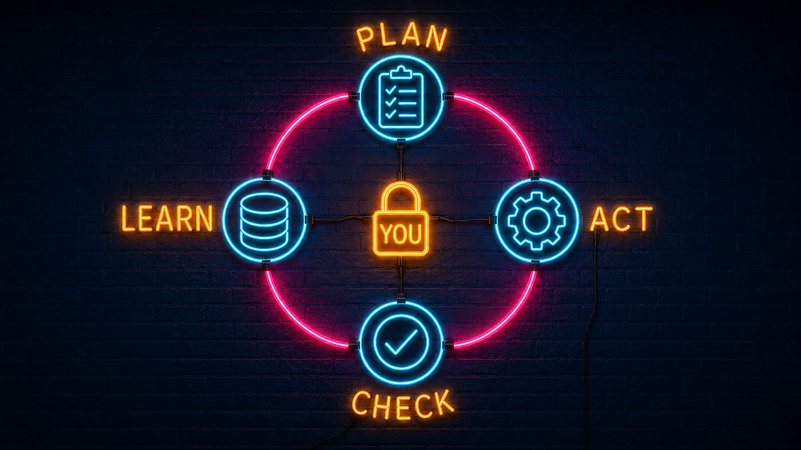

# Agent 领域日报 · 2026-10-31

> 面向公开读者的核验简报｜资料截点：2026-10-31（UTC）

今天的信号集中在“把 Agent 做成可维护的软件系统”：开源项目在发布、部署、记忆与安全护栏上持续工程化；研究侧则把多 Agent 协作推进到可验证的实验闭环。本文只收录可直接访问的一手仓库、提交或论文页面。

## 今日要点

| 信号 | 为什么值得关注 |
| --- | --- |
| Ruflo 发布 3.66.0 | 发布说明把学习循环、经典 hooks 与 CI 修复放进同一版本，说明 Agent harness 正在从 demo 走向可持续维护。 |
| LangGraph 继续修 CLI 部署体验 | 当 Agent 工作流进入生产，部署提示和默认行为本身就是可靠性的一部分。 |
| 多 Agent 实验室论文出现可复现实验闭环 | 研究代理开始把“提出问题—质疑—实验—修订”写进流程，而不是只生成报告。 |
| VeriCUA 将验证视为主动探索 | 对 computer-using agent 而言，判断“完成”比生成动作更难；动态取证是值得跟踪的方向。 |

## 开源项目

### Ruflo 3.66.0：学习循环进入 harness 版本发布

Ruflo 官方仓库的最新提交为 `release: 3.66.0`，提交说明包含 classic hooks 的 learning loop、lessons 命名规范与 update-check CI 修复。它值得关注，不是因为版本号本身，而是因为“经验如何沉淀并回流到下一次执行”已经成为 Agent 基础设施的显式维护对象。

*图：Ruflo 官方仓库文档配图，说明 Agent harness 的组成；原始来源：[Ruflo 文档图片](https://github.com/ruvnet/ruflo/blob/main/docs/assets/ruflo-explained/ch14.jpg)。*

- 项目：[ruvnet/ruflo](https://github.com/ruvnet/ruflo)
- 一手变更：[3.66.0 提交](https://github.com/ruvnet/ruflo/commit/0d94037eb149967cba66daad2898563892c53a02f)

### LangGraph：CLI 部署提示持续打磨

LangGraph 官方仓库 10 月 31 日提交移除了过时的 deploy private-beta 提示。这个改动很小，却直接影响开发者对部署状态的判断；在 Agent 系统中，准确的 CLI 文案能减少误配置和错误预期。

- 项目：[langchain-ai/langgraph](https://github.com/langchain-ai/langgraph)
- 一手变更：[remove outdated deploy private-beta notice](https://github.com/langchain-ai/langgraph/commit/e5c961d7fbe7ca6fdd4c94c84d90511372514d55)

### FastMCP：把对抗性审查标准沉淀为仓库技能

FastMCP 官方仓库最新提交将 adversarial triage review standards 移入 repository skill。它反映出 MCP 生态正在把安全审查从口头规范变成可复用、可版本化的工程资产。

- 项目：[PrefectHQ/fastmcp](https://github.com/PrefectHQ/fastmcp)
- 一手变更：[Move adversarial triage review standards into a repository skill](https://github.com/PrefectHQ/fastmcp/commit/ffccd325f99b44626ddca0e86681f599dd462bb5)

## 论文 / 研究

### 协作 Agent 自主完成量子实验研究

论文 [Collaborative AI agents for autonomous experimental research with solid-state quantum spins](https://arxiv.org/abs/2610.40589)（2026-10-29）描述了一个能提出问题、互相审查、设计实验并在测量漂移时拒绝接受初始结果的多 Agent 实验室。价值在于它把“停止或重定向调查”作为系统能力，而非把 Agent 当作单向写作助手；论文还给出代码仓库 [E-zClap/auctopus](https://github.com/E-zClap/auctopus)。

### VeriCUA：用主动取证验证 computer-using agent

[VeriCUA](https://arxiv.org/abs/2610.40578) 将验证建模为动态证据收集：先构造任务 rubric，再选择 GUI 或代码检查，最后依据显式证据规则合并结果。对训练、评测和线上拒绝“虚假完成”都很重要，因为单次截图或单个 VLM judge 往往看不到决定性状态。

### 在生成前探测 Agent 是否即将泄密

[Pre-Crime for Agents, at the Last Second](https://arxiv.org/abs/2610.40588) 研究在多 Agent 劝诱场景中，于模型输出前读取内部信号以识别即将泄露秘密的调用。作者报告在线性 probe 上的早期预警效果，但也明确指出误报高、会把获准披露一起标记；这更像风险探测器的研究结果，而不是可直接部署的安全保证。

## 业界动态

- GitHub 的 Agent 相关开源活动仍然密集：截至今日，LangGraph、Ruflo、FastMCP 与 Sim 等项目均有当天提交。这里把“有提交”作为可核验的活动信号，不把它夸大为产品发布或用户增长结论。
- 研究与工程正在汇合：论文中的验证、停止条件和证据链，正对应开源 harness 中的 hooks、审查技能和部署工具。下一步值得观察这些机制是否会形成跨框架的可移植接口。

## 趋势 / 编辑简评

Agent 领域的竞争焦点正在从“谁能调用更多工具”转向“谁能在不确定时留下证据、及时停下并复盘”。今天的三个一手信号——学习循环、仓库级安全审查、主动验证——共同指向同一件事：可观测性和可纠错性会成为 Agent 平台的基础产品能力。对团队而言，优先投资日志、评测集、停止条件与可回滚工作流，可能比再增加一个演示型工具更有长期回报。

## 完整来源

1. [Ruflo repository](https://github.com/ruvnet/ruflo) · [3.66.0 commit](https://github.com/ruvnet/ruflo/commit/0d94037eb149967cba66daad2898563892c53a02f)
2. [LangGraph repository](https://github.com/langchain-ai/langgraph) · [CLI commit](https://github.com/langchain-ai/langgraph/commit/e5c961d7fbe7ca6fdd4c94c84d90511372514d55)
3. [FastMCP repository](https://github.com/PrefectHQ/fastmcp) · [repository skill commit](https://github.com/PrefectHQ/fastmcp/commit/ffccd325f99b44626ddca0e86681f599dd462bb5)
4. [Collaborative AI agents for autonomous experimental research](https://arxiv.org/abs/2610.40589)
5. [VeriCUA](https://arxiv.org/abs/2610.40578)
6. [Pre-Crime for Agents, at the Last Second](https://arxiv.org/abs/2610.40588)
